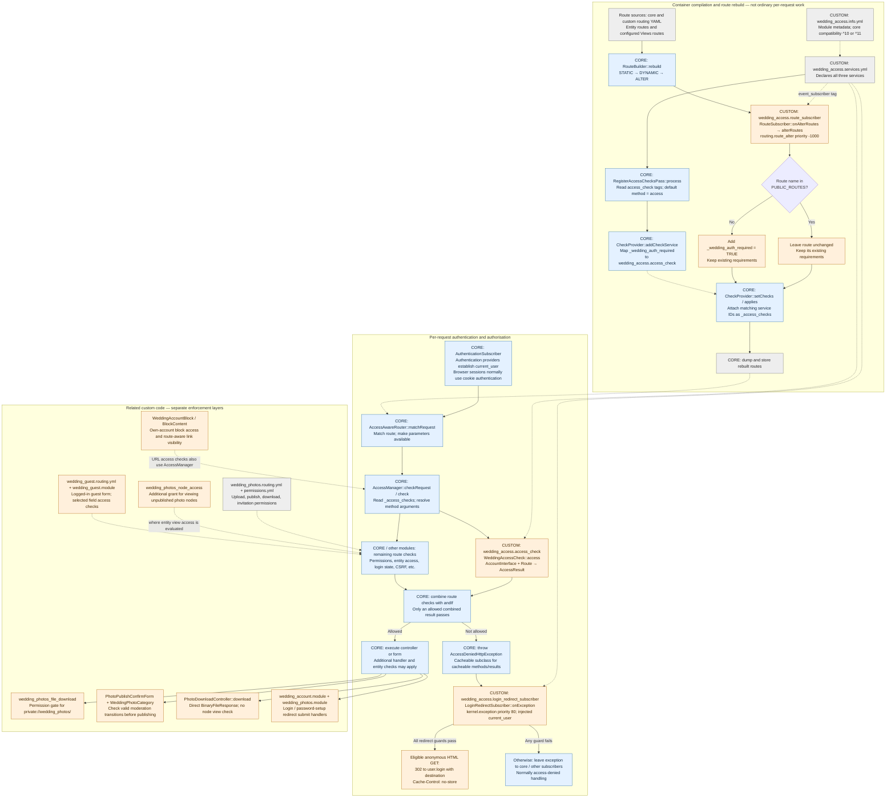
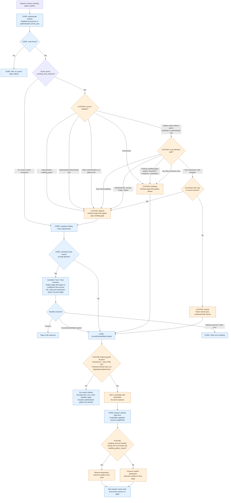

# Wedding access architecture

This is a source-code analysis of the complete `wedding_access` module and related custom access controls, prepared on 20 October 2026. The checked-out core identifies itself as Drupal **11.4.8** in `web/core/lib/Drupal.php`. No Drupal commands, configuration changes or live requests were used.

**The central rule:** `wedding_access` adds an extra access check to almost every Drupal route. Anonymous users fail it. Most authenticated users pass it. Accounts with `wedding_gallery_viewer`, without any of three exempting roles, face a route-path allowlist. Passing this custom check does **not** override the route's other requirements.

## Scope and evidence limits

All five files in `web/modules/custom/wedding_access` were examined. Related code in `wedding_photos`, `wedding_account` and `wedding_guest`, together with the relevant local Drupal core implementation, was inspected.

No exported `views.view.*` or `user.role.*` configuration was found in the project file inventory. Therefore the gallery View's actual path, access plugin, filters, and role-permission assignments cannot be established here. Custom code references `view.wedding_photos_gallery.page_1` and allows the route template `/photos/gallery`, but does not itself define that View route. Its existence and those settings remain configuration dependencies. Module files also do not prove which modules are enabled or whether the deployed route table reflects this source.

In the diagrams, blue represents **Drupal core**, orange represents **custom code**, and grey represents **configuration or stored definitions**. Dashed connections indicate dependencies rather than an execution order. Route building and normal request processing are separate phases.

## 1. Module architecture



Connections from the handler to related modules represent possible handler-specific work, not steps run for every page. The architecture diagram likewise does not prescribe the order of individual access-check services.

### Service registration and route alteration

The module contains no routing YAML and defines no page/controller of its own:

| File under `web/modules/custom/wedding_access/` | Responsibility |
| --- | --- |
| `wedding_access.info.yml` | Module discovery metadata; describes the authentication gate. |
| `wedding_access.services.yml` | Registers `wedding_access.access_check`, `wedding_access.route_subscriber`, and `wedding_access.login_redirect_subscriber`. The redirect subscriber receives `@current_user`; the checker receives its account and route as method arguments. |
| `src/Routing/RouteSubscriber.php` | Extends core `RouteSubscriberBase`; `getSubscribedEvents()` registers inherited `onAlterRoutes()` at priority **-1000**. The inherited method calls custom `alterRoutes()`. |
| `src/Access/WeddingAccessCheck.php` | Implements core routing `AccessInterface`; `access()` returns a cacheable access result. |
| `src/EventSubscriber/LoginRedirectSubscriber.php` | Implements `EventSubscriberInterface`; `onException()` conditionally replaces a 403 exception with a login redirect. |

During `RouteBuilder::rebuild()`, core collects static and dynamic routes, dispatches the ALTER event, attaches access check service IDs, then dumps routes. The custom subscriber runs after higher-priority ALTER subscribers. Priority -1000 does not guarantee that nothing runs later: a subscriber with a lower priority could still add or change routes afterwards.

`RouteSubscriber::alterRoutes()` loops over every route currently in the collection. It skips exactly these **route names**, not path prefixes:

- `user.login`
- `user.pass`
- `user.reset`
- `user.reset.form`
- `user.reset.login`
- `user.cancel_confirm`
- `user.well-known.change_password`

Every other route receives `_wedding_auth_required = TRUE` through `setRequirement()`. Existing `_permission`, `_entity_access`, `_csrf_token`, `_access`, and other requirements remain in place. Being in `PUBLIC_ROUTES` means only “no added wedding gate”: for example, core's well-known password-change route still requires login, and cancellation confirmation retains entity access checks.

Core `RegisterAccessChecksPass::process()` reads the service's `access_check` tag with `applies_to: _wedding_auth_required`. It registers the default callable method `access` with `CheckProvider`. At route rebuild, `CheckProvider::applies()` matches the **presence of the requirement key**, and `setChecks()` stores the service ID in route option `_access_checks`.

The requirement is not a magic Drupal keyword and is not interpreted as a login rule by core. The service tag gives it meaning. `WeddingAccessCheck::access()` does not inspect the requirement's value: changing TRUE to FALSE while leaving the key present would not disable this checker.

### Per-request access checking

Authentication identifies the account; authorisation decides what that account may do. Core's `AuthenticationSubscriber::onKernelRequestAuthenticate()` runs at request priority 300 and establishes `current_user` through authentication providers. The custom module does not verify passwords, create sessions or authenticate users.

Core `AccessAwareRouter::matchRequest()` obtains the matched route and request parameters, then calls `AccessManager::checkRequest()`. `AccessManager::check()` reads `_access_checks`; `performCheck()` asks `CheckProvider::loadCheck()` for each callable and resolves arguments, including the account and `Route`. This invokes `WeddingAccessCheck::access()` without a controller calling it explicitly.

Core combines route-check results using `andIf()`. A custom **allowed** result means only that the wedding gate passes. A forbidden result prevents access; a neutral combined result also fails because the router requires `isAllowed()`. In particular, `AccessResult::allowedIf(FALSE)` returns **neutral**, not forbidden.

The custom checker uses `cachePerUser()` throughout, and adds the `route` context for own-account decisions. This is access-result cache metadata, not a login redirect. Core carries combined access-result metadata into request/response handling; the anonymous redirect explicitly uses `no-store`.

### Gallery-only policy

`WeddingAccessCheck::access()` defines gallery-only as:

```text
has wedding_gallery_viewer
AND lacks wedding_guest
AND lacks wedding_photo_moderator
AND lacks administrator
```

Other unrelated roles do not remove this restriction. A user with both guest and gallery roles follows the ordinary authenticated branch. An account with no wedding role at all also follows that branch.

For gallery-only accounts the checker compares **the matched route's definition path** (`$route->getPath()`), not the incoming URL or alias:

| Allowed route template | Scope and remaining checks |
| --- | --- |
| `/photos/gallery` | Passes this gate, if a route with that exact path exists; View access remains independent. |
| `/system/files/{filepath}` | Core private-file route; downstream file-download hooks still apply. |
| `/system/files/{scheme}` | Core file route; scheme and downstream download controls remain. |
| `/system/files/styles/{image_style}/{scheme}` | Core private image-style route; image delivery checks still apply. |
| `/user/logout` | Core login and CSRF requirements remain. |
| `/user/logout/confirm` | Core login requirement remains. |
| `/user/{user}` and `/user/{user}/edit` | Conditional: the globally current route's converted `user` parameter must be a `UserInterface` with the current account's ID. Core entity access still applies. |

All other routes **carrying the wedding requirement** are forbidden to gallery-only accounts. The seven excluded routes bypass this checker entirely and retain core's own rules.

### Access-denied handling

`LoginRedirectSubscriber::onException()` runs on `kernel.exception` at priority **80**. It redirects only when all these conditions hold:

1. This is the main request.
2. The throwable is an `AccessDeniedHttpException` (including core's cacheable subclass).
3. The current user is anonymous.
4. The method is **GET** and Drupal's request format is **html**.
5. The request has a matched route object with `_wedding_auth_required`.
6. The route name exists, does not start with `user.reset`, and is not `user.login`, `user.pass`, or `user.register`.

The response is **302** to `user.login`, with a `destination` assembled from the original internal path and query. An existing query `destination` is removed before constructing the new destination. The response has `Cache-Control: no-store`.

This is an exception response, not authentication and not a route alteration. It can handle a qualifying 403 thrown later by a controller too; it does not verify that the wedding checker caused the denial. POST, HEAD, non-HTML, subrequests, unmatched 404s and authenticated denials receive no custom redirect. Core or other subscribers handle them. Core authentication exception listeners use priorities 80 and 75; priority 80 alone does not establish ordering between listeners sharing that priority.

## 2. Request lifecycle

This chart assumes a request reaches Drupal's routing system with routes rebuilt from the present code. Ordinary pages mean existing non-exempt wedding routes outside the gallery allowlist. “Gallery” below means an existing route whose definition path is exactly `/photos/gallery`; its configured View access must still pass.



The chart groups checks by meaning. Core can evaluate the other route checks as part of the same `AccessManager` loop; this is not a promise that the custom check runs first. A valid login is required for the successful submit branch; invalid credentials leave the visitor unauthenticated.

### Outcomes for the four requested visitor types

| Visitor | Ordinary protected wedding page | Gallery route at `/photos/gallery` | Denial/redirect behaviour |
| --- | --- | --- | --- |
| Anonymous | Wedding gate forbids. | Wedding gate forbids, regardless of any gallery permission. | Eligible main HTML GET redirects to login with destination. Other requests retain normal error handling. |
| Authenticated `wedding_guest` | Wedding gate allows; existing page/entity permissions still decide. `/guest-details` specifically requires login, not the guest role. | Wedding gate allows; actual View access depends on configuration. | No custom access-denied redirect. Ordinary login preserves destination, otherwise goes to the front page. |
| Authenticated `wedding_gallery_viewer`, without exempting roles | Wedding gate forbids. | Wedding gate allows this exact route template; actual View access and image permissions still decide. | Forbidden pages do not redirect to the gallery: normally 403. Ordinary login sends an account with exactly this one non-locked role to the gallery, overriding destination. |
| Authenticated account with role ID `administrator` | Wedding gate allows. | Wedding gate allows. | Core permissions/entity rules still decide; this custom role exemption is not a universal bypass. No custom denial redirect. |

For example, a guest's request for an unpublished or otherwise inaccessible node can still fail core node access despite passing the wedding gate. An administrator's permissions depend on role configuration; the role's name alone does not prove its core administrator status. Conversely, a core administrator with gallery-viewer role but none of the three literal exempting role IDs is still gallery-only according to this custom code.

### Photo routes and file access outside `wedding_access`

Paths and permissions below come from `web/modules/custom/wedding_photos/wedding_photos.routing.yml` and `wedding_photos.permissions.yml`. Permission definitions declare available permissions; they do not assign them to roles.

| Route | Existing requirement / handler | Gallery-only effect |
| --- | --- | --- |
| `wedding_photos.upload`, `/photos/upload` | `upload wedding photos`; `PhotoUploadForm` stores uploads at `private://wedding_photos/` and creates pending photo nodes. | Wedding gate forbids, even with permission. |
| `wedding_photos.upload_success`, `/photos/upload-success` | `upload wedding photos`; success controller. | Wedding gate forbids. |
| `wedding_photos.publish`, `/photos/{node}/publish` | `view unpublished wedding photos`; `PhotoPublishConfirmForm::buildForm()` and `submitForm()` require the photo bundle, pending state, and a valid transition to published. | Wedding gate forbids. |
| `wedding_photos.download`, `/photos/{node}/download` | `download wedding photos`; converted node passed to `PhotoDownloadController::download()`. | Wedding gate forbids. |
| `wedding_photos.gallery_invitations`, `/photos/invitations` | `manage wedding gallery invitations`; `GalleryInvitationForm::submitForm()` creates active gallery-viewer accounts and sends one-time login invitations. | Wedding gate forbids. |
| Gallery and moderation Views | Referenced by custom code; route/access configuration absent from this repository. | Only exact `/photos/gallery` is allowlisted; `/photos/moderate` would be forbidden. |

`wedding_photos_file_download()` in `wedding_photos.module` returns:

- `NULL` for URIs outside `private://wedding_photos/`, leaving decisions to other hooks.
- `-1` when the account lacks `view wedding photo gallery`.
- File headers when that permission is present.

Core `system\FileDownloadController::download()` aggregates file-download hook results; any `-1`, or no granting headers, denies delivery. Core `ImageStyleDownloadController::deliver()` likewise invokes file-download hooks for non-public image delivery, in addition to its image/style checks. Thus permission to enter the gallery does not by itself establish permission to receive its private images. The allowlisted system file routes are not limited to wedding-photo files: other paths depend on their own download hooks.

`wedding_photos_node_access()` returns an additional permission-based result only for **viewing unpublished `wedding_photos` nodes**. For published photos, other bundles or other operations it returns neutral. Lacking `view unpublished wedding photos` also yields neutral, not a veto; other entity-access grants may still apply. This hook neither enforces published-photo privacy by itself nor automatically runs when arbitrary code reads file bytes.

`WeddingPhotoCategory::viewsFormSubmit()` checks photo bundle, pending state and valid publication transitions before bulk publishing. This is additional action-level authorisation, separate from access to the moderation View.

### Account and guest-module boundaries

In `wedding_account.module`, `wedding_account_login_redirect()` runs after core login form submission. It preserves an explicit destination for ordinary users and otherwise uses the front page. Exactly-one-role gallery viewers have the destination removed and are sent to the gallery. `wedding_account_initial_password_redirect()` applies similar handling after initial password setup, attached when the account form request has `pass-reset-token`.

`wedding_photos_form_user_form_alter()` separately attaches `wedding_photos_gallery_activation_redirect()` when `user_pass_reset` is set and the account has exactly the gallery-viewer role. That callback sets a gallery redirect, but does not itself remove destination. Both modules can therefore participate in password-setup redirects; final behaviour also depends on the form conditions, submit ordering and core destination handling.

`WeddingAccountBlock::blockAccess()` permits its dashboard only on the current user's own canonical account page. Its `build()` hides guest-response and personal-photo sections for gallery-only accounts using the same role predicate as `WeddingAccessCheck`. `WeddingAccountBlockContent::build()` uses `Url::access()` for upload/moderation link visibility, so route checks also run during link-building. These are block/UI controls, not replacements for endpoint access checks. `wedding_account_form_user_form_alter()` hides account fields on applicable self-edit forms while retaining core account-form validation.

`wedding_guest.guest_details` in `wedding_guest.routing.yml` requires `_user_is_logged_in: TRUE`. The wedding gate additionally blocks gallery-only users, but there is no `wedding_guest` role requirement. `GuestDetailsForm` loads and saves the current user's responses. `wedding_guest_entity_field_access()` protects viewing/editing the three response fields: own-user access is allowed, `view wedding guests responses` permits viewing others, and other requests are forbidden. This is field access, distinct from route access. `GuestStatus`, `GuestResponse` and the response-summary block provide completion/data/display logic; they do not add another route gate. `GuestResponse::getResponse()` reads stored values directly, so callers must maintain their own access boundary.

## Findings and potential weaknesses

1. **Authentication is not wedding membership.** The final branch of `WeddingAccessCheck::access()` allows every authenticated account that does not meet the gallery-only predicate. No guest role, invitation, or guest-completion requirement protects ordinary pages at this layer. Existing route permissions may narrow access, but a general logged-in account can pass the wedding gate, including at `/guest-details`.

2. **Original-photo downloads omit entity view/publication checks.** `PhotoDownloadController::download()` checks the photo bundle, field/file presence and local file existence, then returns a direct `BinaryFileResponse`. The route requires `download wedding photos`, but has no `_entity_access: node.view`; the controller does not call `$node->access('view')`, check publication, or invoke file-download hooks. An authenticated non-gallery-only user with that download permission can request a known pending photo node's original, regardless of whether they could view that node. The direct response also does not require `view wedding photo gallery`. This is a concrete missing check; actual exposure depends on permission assignments and available nodes/files.

3. **Private-file permission is broader than publication state.** `wedding_photos_file_download()` checks the gallery permission for every URI under the wedding-photo directory; it does not inspect the owning photo node, publication state or ownership. This hook supplies no unpublished-file restriction. Other hooks can veto delivery, so a live leak cannot be concluded from this hook alone. Keeping pending images out of gallery results is not itself a file-delivery access check.

4. **“Gallery-only” has inconsistent definitions.** Access checking and `WeddingAccountBlock` exclude the three privileged wedding roles but tolerate unrelated extra roles. Login/activation handlers require exactly one non-locked role. A gallery viewer with an unrelated extra role remains restricted yet can keep a destination pointing at a forbidden ordinary page, or be redirected to the forbidden front page after login.

5. **The gallery View's security cannot be verified from the available files.** The permission `view wedding photo gallery` is declared and enforced on private wedding-photo downloads, but no custom gallery routing YAML attaches it to `/photos/gallery`. Whether the View enforces this permission, filters unpublished nodes and exposes suitable rows requires its actual configuration. A missing/changed View path can also leave gallery viewers locked out despite a gallery redirect.

6. **Path templates create maintenance and secondary-check risks.** The allowlist grants by exact route template rather than route name; a different route sharing a template would also pass this gate, while a renamed template would fail. Aliases do not create a new allowed route template. The own-account branch uses global `\Drupal::routeMatch()` instead of the route match being checked: `AccessManager::checkNamedRoute()` can evaluate a different target route while the global route still refers to the current page. Link/access-query results can therefore disagree with actual incoming-request ownership checks. This is a correctness risk, not evidence of an incoming-request ownership bypass.

7. **Blanket route gating affects infrastructure and APIs.** There are no special exemptions for core's `/cron/{key}`, JSON login/password endpoints, public image-style generation routes, or other service endpoints. For example, anonymous JSON `user.login.http` is gated despite HTML `user.login` being exempt; anonymous POST denials do not receive a login redirect. Core public image styles can be blocked when generated through Drupal, while already-existing public files served by the web server bypass this module. The module protects routed Drupal requests, not all bytes served by the site. `settings.php` sets a private directory outside `web`, and the upload form uses private storage, but deployment-level web-server protection was not verified.

8. **Gallery account shortcuts are not allowlisted.** Core `user.page` (`/user`) and `user.edit` (`/user/edit`) are forbidden for gallery-only accounts, even though the canonical own-account paths are conditionally allowed. Registration is gated and explicitly excluded from anonymous login redirects. None of the seven public exceptions is automatically forbidden to gallery viewers by this module; core retains control over them.

9. **Field-hook scope deserves review.** `wedding_guest_entity_field_access()` selects protected fields by field name and compares entity ID with account ID without first restricting the entity type to user. If a different entity type reuses those field names, matching numeric IDs could be treated as ownership. The current source does not establish whether such fields exist elsewhere. Direct entity reads and custom form saves do not automatically enforce this hook.

## Suggested validation (not performed)

Use test accounts for anonymous, guest, gallery-only, gallery-plus-unrelated-role, and administrator cases. Check both ordinary pages and the gallery, own/other account pages, `/user`, `/user/edit`, logout, upload/download, moderation and invitations. Confirm denied authenticated requests stay denied rather than redirecting.

Inspect the actual role permissions and gallery/moderation View configuration. Verify HTML login and one-time-password flows with and without destinations; contrast HTML GET, HEAD, POST and JSON requests. Check private originals and styled images for published and pending photos, including direct original-download URLs. Confirm infrastructure routes such as cron behave as intended and that private files cannot be served directly by the web server.

## Core source reference map

All paths below are relative to the project root; these were inspected locally rather than inferred from external documentation.

| File | Relevant methods / role |
| --- | --- |
| `web/core/lib/Drupal/Core/DependencyInjection/Compiler/RegisterAccessChecksPass.php` | `process()`: register tagged access services and default callable method. |
| `web/core/lib/Drupal/Core/Routing/RouteSubscriberBase.php` | `onAlterRoutes()`: delegate route-build event to `alterRoutes()`. |
| `web/core/lib/Drupal/Core/Routing/RouteBuilder.php` | `rebuild()`: event phases, attach checks, dump routes. |
| `web/core/lib/Drupal/Core/Access/CheckProvider.php` | `addCheckService()`, `applies()`, `setChecks()`, `loadCheck()`. |
| `web/core/lib/Drupal/Core/Access/AccessManager.php` | `checkNamedRoute()`, `checkRequest()`, `check()`, `performCheck()`. |
| `web/core/lib/Drupal/Core/Access/AccessResult.php` | `allowedIf()` and `allowedIfHasPermission()`: false conditions yield neutral. |
| `web/core/lib/Drupal/Core/Routing/AccessAwareRouter.php` | `matchRequest()`, `checkAccess()`: match and enforce combined access result. |
| `web/core/lib/Drupal/Core/EventSubscriber/AuthenticationSubscriber.php` | Request authentication, routed provider filtering and exception events. |
| `web/core/modules/user/user.routing.yml` | Login/reset/logout/register and account shortcut route definitions. |
| `web/core/modules/system/system.routing.yml` | File routes, cron and their existing requirements. |
| `web/core/modules/system/src/FileDownloadController.php` | `download()`: enforce file-download hook grants/vetoes. |
| `web/core/modules/image/image.routing.yml` | Private image-style route definition. |
| `web/core/modules/image/src/Routing/ImageStyleRoutes.php` | `routes()`: dynamic public image-style route and static-delivery boundary. |
| `web/core/modules/image/src/Controller/ImageStyleDownloadController.php` | `deliver()`: image delivery and non-public file-download hooks. |
